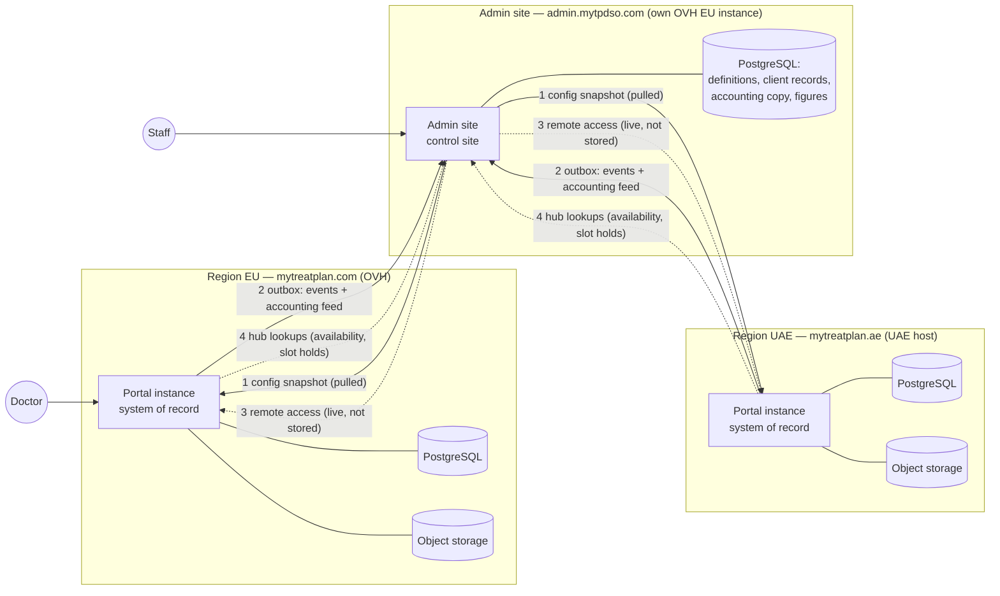
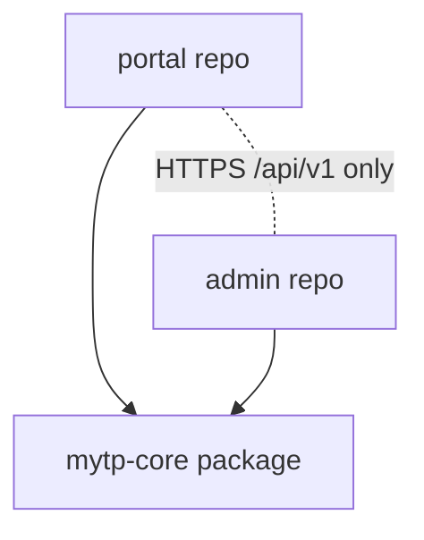
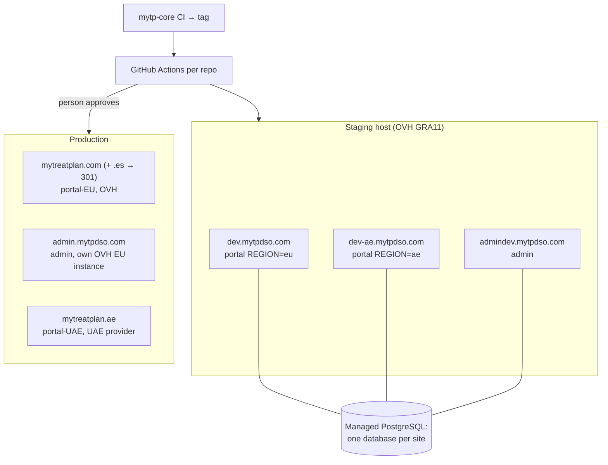

# Architecture Spine — MyTreatPlan regional portals and admin site

## Design Paradigm

**Hub and spoke.** Each **regional portal instance** (spoke) is the system of record for its region's doctors, patients, orders, invoices, cases and files. The **admin site** (hub) is the control site: it owns the definitions every region uses and holds only the copies it may store; it reads and changes regional data through the region's API and never stores patient data. Spokes push what the hub may keep through an outbox; the hub never touches a spoke's database.

Inside each deployment: a **modular Django monolith**. Each Django app is a module; every write goes through that app's `service.py`; views, tasks and interface endpoints call services, never the ORM for writes. New apps follow this from the start; part-1 apps (only `eventlog` has a service today) adopt it when an epic changes them.



## Invariants & Rules



`portal` and `admin` never import each other; both depend only on `mytp-core`; they meet only over the versioned HTTPS interface.

### AD-1 — Regional systems of record, central control site

- **Binds:** all
- **Prevents:** two owners of one entity; a central database replicating regional data.
- **Rule:** Every entity has exactly one owner, per AD-2. The owner is the only place it is created or changed; any other site holds a read copy or reads it live. The admin site never connects to an instance database. **[ADOPTED]**

### AD-2 — Data placement and field encryption

- **Binds:** all
- **Prevents:** patient data landing centrally; an epic storing a copy it may not hold; sensitive fields stored in clear.
- **Rule:** Owner, central copy and field encryption per entity. Anything not listed is regional-only and its epic adds a row here before building it.

| Entity | Owner | Central copy | Field-encrypted |
| --- | --- | --- | --- |
| Doctor account, profile, fiscal entities, shipping addresses | Region | Client record (encrypted with the admin's keys) | Names, contact data, fiscal ids |
| Maker logins | Region | No | Username and password |
| Patients (names, photo, comments) | Region | No (code only) | Names, comments; photo in object storage |
| Work orders, stages, assignment, appointments | Region | Events without patient data (AD-21) | Free-text comments |
| Records, STL files, photos, ticket attachments | Regional object storage | No | Original file name; objects encrypted at rest |
| Orders, invoices, credit notes, payments | Region | Accounting copy with patient codes | Buyer fiscal data |
| Voucher redemptions, current subscription | Region | Events | — |
| Support tickets | Region | No | Text |
| Contact messages | Region | Yes | Names, contact data |
| Catalogue, subscriptions, billing rules, vouchers, country map | Admin | — (instances hold a signed snapshot) | — |
| Admin users, roles, calendars, slot holds, admin directory | Admin | — | Contact data |

The admin site keeps no patient data anywhere (AD-23). **[ADOPTED]**

### AD-3 — The interface: four channels over HTTPS + JSON

- **Binds:** P3 and every epic that exchanges data
- **Prevents:** each epic inventing its own transport, ordering, retry or delivery semantics.
- **Rule:**
  1. **Configuration:** the instance pulls a signed, versioned snapshot from the admin site on a schedule and when nudged; it applies only a snapshot with a higher version, atomically, and keeps working on the last one when the admin site is down.
  2. **Outbox (events and accounting feed):** written in the same transaction as the change; each row carries a per-aggregate sequence; a dispatcher sends them in order per aggregate and keeps attempts, next retry and last error **on the row**; the admin site deduplicates on `event_id`, applies an aggregate's event only when its version is higher than the stored one (AD-18), and a rejected event stays visible as failed for an operator.
  3. **Remote access (admin → region, live):** server-side calls whose responses are rendered and never persisted; every write carries an idempotency key and the entity's version, and a stale version is refused with 409.
  4. **Hub lookups (region → admin, live):** reads of admin-owned live data, limited to specialist availability and slot holds (AD-21); when the admin site is down, booking is unavailable and nothing else is.
  No message broker. No direct database access across sites. Tasks are enqueued with `transaction.on_commit`. **[ADOPTED]**

### AD-4 — Trust between sites

- **Binds:** P2, P3
- **Prevents:** replayed or redirected requests; an admin-site bug bypassing a region's access rules; shared secrets between sites.
- **Rule:** Each site signs its requests with its own Ed25519 key (JWT EdDSA through PyJWT); sites exchange public keys only, each identified by `kid`, with an overlap period on rotation and a revocation runbook. Claims: `iss`, `aud` (the receiving site), `iat`, `exp` ≤ 60 s, `jti` (rejected if seen within its lifetime), and a hash of method, path and body. An outbox event's `region` must match the signing site. Config snapshots are signed by the admin key. Remote-access tokens also carry the admin user's UUID, role and permitted regions; **the instance checks the permission itself (AD-17) and writes the access log before returning data; if the log cannot be written, the data is not returned.** Nginx allowlists peer IPs on `/api/` in production; on staging the token audience separates the three sites. Private signing keys are wrapped by the site's KMS like field keys. **[ADOPTED]**

### AD-5 — Identifiers and the patient code

- **Binds:** all
- **Prevents:** id collisions across instances; patient identity leaking through codes or object keys.
- **Rule:** A record that crosses sites is referenced only by a UUID; integer primary keys never leave an instance. Existing part-1 tables keep their integer key and gain an immutable `uid` UUID; new tables use a UUID primary key. Every patient gets a **patient code**: region prefix + `-` + 8 random Crockford base32 characters (e.g. `EU-7K3QX9MD`), generated once, never reused, never derived from patient data. Central records, invoices and logs refer to patients only by this code. Object-storage keys are UUIDs, never file or patient names. **[ADOPTED]**

### AD-6 — Money

- **Binds:** P4, P6, P7, P8, P12
- **Prevents:** float rounding; an amount separated from its currency; prices recomputed after the sale.
- **Rule:** An amount is a `Decimal` quantized to 0.01 plus an ISO 4217 code (EUR, AED, USD), carried together by the `Money` type in mytp-core; never a float. Catalogue prices are **net**; VAT is added at checkout. Each order line snapshots price, discount, VAT rate or exemption text, billing company and provider cost at order time and is never re-read from the catalogue. Catalogue items are never hard-deleted (deactivated only). Conversion between currencies happens only when staff clone a product. **[ADOPTED]**

### AD-7 — Invoices

- **Binds:** P7, P8, P12, P15
- **Prevents:** duplicate or reused invoice numbers; patient names fixed into immutable documents; invoices tied to an account that may not exist.
- **Rule:** The regional instance issues invoices and credit notes. Each billing company has a gapless invoice series and a separate credit-note series per instance, prefixed with the instance; numbers are assigned in a locked transaction at issue time and, after any database restore, numbering resumes above the highest number in either the instance or the admin's accounting copy. An invoice's buyer is the fiscal-entity snapshot taken at issue (so a manual invoice may bill someone without a doctor account). Invoice lines store the **patient code**; the doctor's view and PDF add the patient's current name at render time, so an erased patient leaves only the code. VAT is computed per invoice on the sum of lines at each rate, rounded half up to the cent; a 0 rate carries its exemption text. Invoice dates and series years use the billing company's legal time zone. Issued invoices are immutable; corrections are credit notes. **[ADOPTED]**

### AD-8 — Background work

- **Binds:** all
- **Prevents:** a second queue technology; double effects when a task reruns; retry logic tied to one backend.
- **Rule:** Scheduled jobs are systemd timers running `manage.py runjob <name>` with Sentry cron check-ins whose slugs include the site name. On-demand work is a task written against Django's `django.tasks` API, run by one PostgreSQL-backed worker service per site; retries that matter (outbox, webhooks, messages) are tracked on the business row, not in backend-specific task options. Every task is idempotent, keyed by the record's UUID and, for periodic effects such as renewals, by record and period. No Redis, no Celery. **[ADOPTED]**

### AD-9 — Files

- **Binds:** P9, P10, P13, P15
- **Prevents:** large files through the web server; unscanned or unlogged downloads; files or file names outside their region.
- **Rule:** Files live in the region's private S3-compatible bucket, encrypted at rest. Browsers upload straight to it with S3 multipart and presigned part URLs (Uppy `@uppy/aws-s3`); the bucket's CORS exposes `ETag`; a lifecycle rule aborts incomplete uploads after 7 days. New objects land under a quarantine prefix; a ClamAV scan task moves each to the clean prefix or rejects it, and a file the scanner cannot fully scan (size or archive limits) is rejected, never promoted. Downloads are presigned GET URLs valid ≤ 5 minutes, issued only after the permission check and logged in the region. Deleting a file deletes the object and keeps only the trace: object UUID, patient code, who, when — never the file name. The OVH presigned multipart flow is verified by the first story of epic-platform before any upload work starts. **[ADOPTED]**

### AD-10 — Shared code: mytp-core

- **Binds:** P2, P3, P6, P7
- **Prevents:** two drifting copies of login, crypto, signing or the contract; the admin login drifting from its agreed policy.
- **Rule:** The admin login page is public on the internet behind 2FA (no IP allowlist). A third repo, `mytp-core`, versioned with semantic versions and pinned by tag in both repos, holds: field encryption and the key provider, the verification provider, the 2FA building blocks with a per-site policy (doctor: part-1 rules; admin: no web signup or password recovery, remember-this-device for 7 days, a fresh code before downloading patient records), the interface client, token signing and verification, the interface contract definitions with their contract tests, the case stage machine (AD-21) and the `Money` type. Neither site re-implements these. Moving part-1 crypto keeps the old import paths that migrations use. The admin site has its own user table, database and keys; mytp-core shares code, never data. **[ADOPTED]**

### AD-11 — Admin site UI

- **Binds:** P2, P10, P11, P12, P13
- **Prevents:** each epic building its own list, filter and export machinery.
- **Rule:** The admin site is ordinary Django views (not `django.contrib.admin`) on the AdminLTE 4 static assets with HTMX (the `adminlte-django` package is not used). Every list is a django-tables2 table with django-filter filters, giving sorting, search, the fixed columns (internal id, creation date, status, view more) and confirmation before every change. CSV export is available on lists of centrally stored data; lists of regional-only data follow AD-23. Search terms travel in POST bodies, never in URLs. **[ADOPTED]**

### AD-12 — Deployment, environments and version skew

- **Binds:** P14, P15
- **Prevents:** staging that differs from production; a site sharing a production database; sites breaking each other on deploy.
- **Rule:**
  - `provision.sh`, `release.sh`, the systemd units and CI are made site-aware by epic-platform: each site gets its own Linux user, folder, socket, units, database and job list, named by site.
  - Staging runs `dev` (portal, REGION=eu), `dev-ae` (portal, REGION=ae) and `admindev` on one host; production runs each site on its own instance with its own managed PostgreSQL: portal-EU (OVH), admin (OVH, EU), portal-UAE (UAE provider). Sites call each other only over public HTTPS.
  - CI: mytp-core runs its tests and contract tests and publishes a tag; each site's CI deploys staging on every push to master; production deploys need a person's approval.
  - Version skew: the admin site deploys first and serves interface versions n and n−1; readers ignore unknown fields and event types; an instance keeps its current snapshot when a newer snapshot needs a newer instance; both repos move to a new mytp-core minor version before a release that needs it.
  - The admin site is never linked from the mytreatplan domains and is served with `noindex` and a disallow-all robots.txt. **[ADOPTED]**

### AD-13 — Region profile

- **Binds:** P1, P14, P15
- **Prevents:** region logic scattered through the code; a US region needing a fork.
- **Rule:** `REGION` in settings.env selects a profile in code that sets: domains, region company for the footer and legal texts, default time zone, languages, currencies, object-storage endpoint, KMS, gateways available. Code reads region-specific values from the profile or the synced configuration; comparing against a region name outside the profile module is not allowed. **[ADOPTED]**

### AD-14 — Countries, home region, billing country

- **Binds:** P1, P5, P6
- **Prevents:** a country-map change moving existing customers; routing and billing reading different maps.
- **Rule:** The country map (state per ISO country: eu, ae, banned) is owned by the admin site and arrives in the configuration snapshot. Each doctor's **home region** is stored at signup and never recomputed. Geo-IP uses a local DB-IP Lite country database (no IP leaves the instance) and only suggests; the signup country only warns; a fiscal entity whose billing country is outside the instance's region, or banned, is refused. **[ADOPTED]**

### AD-15 — One write path per entity

- **Binds:** P9, P10, P11, P12
- **Prevents:** admin-side changes skipping the side effects of doctor-side ones; retried writes applying twice.
- **Rule:** A change to a regional entity, from the doctor, a task or the admin site, goes through the same instance service function, which checks the entity version, emits its outbox events and sends its doctor messages. Interface endpoints are thin adapters over those services. **[ADOPTED]**

### AD-16 — Catalogue resolution and orders

- **Binds:** P4, P6, P7, P8
- **Prevents:** subscription, ordering and checkout each computing availability, price, VAT or company their own way.
- **Rule:** One resolver in the portal answers, for a doctor's country and subscription: which products are offered, at what net price and discount, by which billing company and through which gateway; the chosen fiscal entity's VIES status then decides the VAT rate or exemption text. Every purchase path calls it; nothing else prices from the snapshot. One order has one billing company, one currency and one gateway (with country-based billing a cart never spans two; the resolver refuses one that would). **[ADOPTED]**

### AD-17 — Authorization

- **Binds:** P2, P10, P12, P13
- **Prevents:** each epic interpreting the six roles differently; region limits applied only to remote data.
- **Rule:** The admin site defines one permission matrix (role × area × action) in code, used by every admin view. Region limits (Commercial Regional Manager) filter central data by the client's home region as well. On remote access the instance applies the same rules from the token: a Clinical User gets only work orders whose assignee is that admin user, and every response omits the fields the role may not see (clinical roles: no financial data; sales and finance roles: no patient names). **[ADOPTED]**

### AD-18 — Client record sync and erasure

- **Binds:** P3, P5, P12
- **Prevents:** an old event overwriting a newer copy; deleted data surviving in the central copy; erasure destroying legally required invoice data.
- **Rule:** Aggregates copied centrally (client record, contact message) are sent as full-state events with an increasing version; deletions travel as tombstones; the admin site can request a full re-sync per aggregate. Only the region erases a doctor (part-1 erasure); it then emits `client.erased` and the admin site deletes the client record. The accounting copy keeps buyer fiscal data as issued for the legal retention period and is never erased by a GDPR request. **[ADOPTED]**

### AD-19 — Retention and deletion

- **Binds:** P9, P10, P13, P14
- **Prevents:** data kept forever in side tables; deletion windows applied differently by different epics.
- **Rule:** Regional jobs own physical deletion: a patient 48 h after being marked, records 7 days after being marked uploaded to the maker; marks come from the doctor or staff through AD-15. Admin-site records are deactivated or logically deleted, never hard-deleted (admin users included). Delivered outbox rows are purged after 30 days; the admin's dedupe table keeps only event ids. Backups follow AD-24 and a restore re-applies deletions made since the backup. **[ADOPTED]**

### AD-20 — Vouchers

- **Binds:** P4, P6, P8, P12
- **Prevents:** a voucher used twice across pending orders or regions; two epics redeeming at different moments.
- **Rule:** A voucher is defined centrally and belongs to one region. Its redemption is a regional entity, unique per voucher and doctor: reserved when the order is created, consumed when it is paid, released when it is cancelled or expires. Redemptions reach the admin site as `voucher.redeemed` and `voucher.released` events. **[ADOPTED]**

### AD-21 — Case stages, assignment and calendar

- **Binds:** P9, P10, P11
- **Prevents:** two stores of the assignment; two timers; the admin forcing a stage the case does not allow; double-booked specialists.
- **Rule:** The case stage machine (stages, allowed transitions, one live work order per patient) is defined in mytp-core and enforced only by the portal service. The admin site requests named transitions, never "set stage". The assignment and its 24 h confirmation timer live in the region; the admin site computes the proposal from its calendars and workload figures received as events (no patient data). Specialist calendars and slot holds are the admin site's; a hold references a work-order UUID only; the portal places a hold through a hub lookup before recording the appointment, so a specialist serving several regions cannot be double-booked. **[ADOPTED]**

### AD-22 — Actor identity

- **Binds:** all
- **Prevents:** shadow admin accounts in each region; logs naming people inconsistently.
- **Rule:** Every regional write and log stores an actor type (doctor, admin, system) and UUID. A small admin directory (UUID, display name, title, active, time zone) travels in the configuration snapshot for display. Regions never create accounts for admin users. **[ADOPTED]**

### AD-23 — Keeping patient data off the admin site

- **Binds:** P10, P11, P12, P13
- **Prevents:** patient data reaching central storage through framework habits.
- **Rule:** Pages built from remote access are sent with `Cache-Control: no-store` and never cached server-side. Patient data never enters task arguments, the cache, flash messages, admin logs, Sentry events, email or SMS bodies, or URLs. Sentry in every site runs with PII off and a scrubber that drops request bodies and named sensitive fields. Interface contract tests reject patient fields in event and accounting payloads. Lists of regional-only data are not exported to CSV with patient names. Messages to doctors and staff identify patients by code only. **[ADOPTED]**

### AD-24 — Operations: backups, keys, monitoring

- **Binds:** P14, P15
- **Prevents:** backups or keys carrying a region's data out of it; restores that rewind invoice numbers; colliding monitors.
- **Rule:** Each region's database, object storage and keys stay in that region: managed PostgreSQL with point-in-time recovery plus an encrypted off-site copy in a second location of the same region (EU: part-1 setup; UAE: a second UAE location); restore tests run on a server in the region, never on a laptop. Each region uses a KMS in that region for field keys and signing keys. Backups older than 30 days are deleted. Every site reports to monitoring with its site name in every slug. **[ADOPTED]**

## Consistency Conventions

| Concern | Convention |
| --- | --- |
| Naming | Django app per module, snake_case; events `<entity>.<past-tense verb>` (e.g. `order.paid`, `client.updated`); Python packages `mytp_core.*`; sites `portal-eu`, `portal-ae`, `admin` |
| Ids and formats | UUIDs as strings; amounts `{"amount": "123.45", "currency": "EUR"}`; timestamps ISO 8601 UTC with `Z`; business dates in the billing company's time zone; countries ISO 3166-1 alpha-2; languages BCP 47 |
| Interface envelope | `{event_id, type, version, aggregate_id, aggregate_version, sequence, occurred_at, region, payload}`; API paths `/api/v<n>/`; breaking change = new version |
| Errors | `{"error": {"code", "message"}}` with the HTTP status; 409 for a stale version; no stack traces across sites |
| Times | Stored UTC; shown in the doctor's profile time zone; specialists see their own; appointments store both zones |
| Texts | Catalogue and subscription texts one per language, synced with the catalogue, English fallback; UI strings through Django's translation catalogues |
| Messages | One notification service per instance; one template per message and language in the portal repo; email first, SMS fallback; patients by code only |
| Logging and audit | Data access and admin actions logged in the region of the data, with actor type and UUID; no patient names, maker logins or file contents in logs |
| Config and secrets | settings.env per site, typed by a person; private keys wrapped by the region's KMS and never leave their site |

## Stack

| Name | Version |
| --- | --- |
| Python | 3.13 |
| Django | 6.1.2 |
| PostgreSQL (managed, TLS) | 17 |
| psycopg | 3.3.6 |
| cryptography | 50.0.2 |
| PyJWT (EdDSA) | 2.15.1 |
| Gunicorn | 26.2.0 |
| Tailwind CSS (portal) | 4.3.3 |
| htmx | 2.0.11 |
| AdminLTE (admin, static assets) | 4.10.0 |
| django-tables2 (admin, with tablib) | 3.0.1 |
| django-filter (admin) | 26.2 |
| django.tasks database backend | chosen at epic-platform inception: django-tasks-db 0.13.0 or django-ox 1.9.1 |
| Uppy (`@uppy/aws-s3`) | 6.x, exact pin at epic-platform inception |
| ClamAV | 1.4.6 or later (1.4 LTS) |
| DB-IP Lite country (MMDB) | monthly release |
| sentry-sdk | 2.71.0 |

## Structural Seed



```text
mytreatplan.com/          # portal repo (existing)
  accounts/ signup/ eventlog/ legal/ mytp_publicsite/   # part 1
  regions/                # REGION profile, country map, geo-IP, home region
  integration/            # outbox, config pull, hub lookups, /api/v1 endpoints (adapters over services)
  catalogue/              # signed snapshot + resolver (AD-16)
  ...                     # one app per capability: profile, payments, subscriptions, orders, cases, support
mytp-admin/               # admin repo (new)
mytp-core/                # shared package (new): crypto, verification, 2FA, interface client + contract, stage machine, Money
```

## Capability → Architecture Map

| Capability / Area | Lives in | Governed by |
| --- | --- | --- |
| P1 Regions | portal `regions` | AD-5, AD-13, AD-14 |
| P2 Admin access | admin; mytp-core 2FA | AD-4, AD-10, AD-11, AD-17, AD-22 |
| P3 Interface | portal `integration`; admin; mytp-core contract | AD-1–AD-4, AD-15, AD-18 |
| P4 Catalogue and billing rules | admin (owner); portal snapshot + resolver | AD-2, AD-6, AD-16, AD-20 |
| P5 Doctor profile | portal | AD-2, AD-14, AD-18 |
| P6 Subscriptions | portal; admin definitions | AD-6, AD-8, AD-16, AD-20 |
| P7 Payments | portal; mytp-core Money | AD-6, AD-7, AD-16 |
| P8 Ordering and invoicing | portal | AD-5, AD-6, AD-7, AD-16, AD-20 |
| P9 Case lifecycle | portal; regional object storage | AD-8, AD-9, AD-15, AD-19, AD-21 |
| P10 Clinical operations | admin over remote access | AD-2, AD-4, AD-15, AD-17, AD-21, AD-23 |
| P11 Appointments | admin calendars and holds; portal case page | AD-3, AD-21, conventions (times) |
| P12 Sales and finance | admin (client record, accounting copy) | AD-2, AD-6, AD-7, AD-11, AD-17, AD-18 |
| P13 Support | portal (tickets, attachments); admin over remote access | AD-2, AD-9, AD-23 |
| P14 Platform | provision.sh, CI, three repos | AD-8, AD-12, AD-24 |
| P15 UAE launch | portal REGION=ae on UAE provider | AD-9, AD-12, AD-13, AD-24 |

## Deferred

- **Gateway adapter interface and webhook handling** (signature, timestamp tolerance, re-reading the payment from the gateway, amount and currency match, dedupe on the gateway's id): epic-payments decides within AD-6, AD-7 and AD-8.
- **Event catalogue and remote-access endpoints per entity:** each epic adds its own under AD-3 and the envelope; epic-admin-interface owns the channels and the contract format.
- **Contract format in mytp-core** (pydantic models vs JSON Schema): epic-admin-interface decides; one shared definition is binding (AD-10).
- **The django.tasks backend package:** chosen at epic-platform inception between the two in Stack; AD-8 keeps retries off the backend.
- **UAE hosting provider and KMS:** chosen in epic-uae-launch's comparison; must offer a Debian VM, managed PostgreSQL with point-in-time recovery, S3-compatible object storage and a KMS in the UAE, plus a second UAE location for backups (AD-9, AD-12, AD-24).
- **Lawyer questions for the UAE** (EU-hosted admin rendering UAE patient data, error monitoring outside the UAE, email/SMS providers outside the UAE): before epic-uae-launch's go-live; AD-23 keeps patient data out of all three meanwhile.
- **Remote desktop for records handling outside the region:** accepted gap for now (initiative Notes).
- **Zoom API and the account pool, WhatsApp channel, chatbot, wholesale, education:** parked in the initiative.
- **Search across regions in admin lists of regional-only data:** fan-out per region by default; a later epic may refine it within AD-2 and AD-23.
- **Upgrade to Django 6.2 LTS** (April 2027): planned after the EU go-live.
